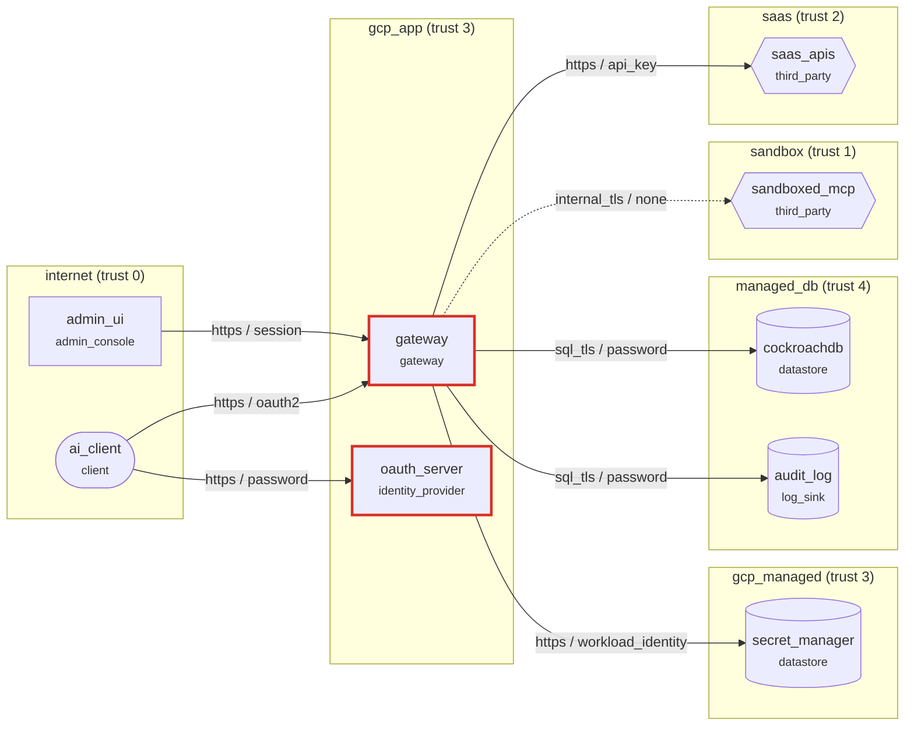

# Security design review: AgentGate (as built)

MCP gateway on Cloud Run. AI clients (Claude, Cursor, service agents) authenticate with OAuth 2.1 and call scoped tools; the gateway decrypts upstream credentials from its vault per call and talks to GitHub, Slack and Jira, or to third-party MCP servers in a local sandbox. State, policy and the hash-chained audit log live in CockroachDB.

**Open findings:** 8 (4 critical, 3 high, 1 medium) · **Accepted risks:** 1

## Data-flow diagram

Dashed edges are plaintext or unauthenticated hops; red components carry open high or critical findings.

## Findings

| Risk | Rating | ID | Element | STRIDE | Lens | Finding |
|---:|---|---|---|---|---|---|
| 25 | critical | TL-A02 | `gateway` | Spoofing | abuse | Login lacks credential-stuffing defenses |
| 25 | critical | TL-A02 | `oauth_server` | Spoofing | abuse | Login lacks credential-stuffing defenses |
| 25 | critical | TL-S02 | `gateway` | Spoofing | access | Internet-facing login without multi-factor authentication |
| 25 | critical | TL-S02 | `oauth_server` | Spoofing | access | Internet-facing login without multi-factor authentication |
| 16 | high | TL-R01 | `oauth_server` | Repudiation | logging | Sensitive actions are not audit-logged |
| 15 | high | TL-A10 | `oauth_server` | Spoofing | access | Long-lived device or API keys are never rotated |
| 12 | high | TL-L02 | `system` | Repudiation | logging | No detection consumes the security logs |
| 8 | medium | TL-S05 | `f_upstream` | Spoofing | access | Service-to-service call uses a static API key |

## Recommended changes: access

- **TL-S02 on `gateway` (critical).** A leaked or phished password is enough to take over an account. **Change:** Offer and default to a second factor (passkeys or TOTP); require it on new devices and for sensitive changes. _(CWE-308 Use of Single-factor Authentication · T1078 Valid Accounts)_
- **TL-S02 on `oauth_server` (critical).** A leaked or phished password is enough to take over an account. **Change:** Offer and default to a second factor (passkeys or TOTP); require it on new devices and for sensitive changes. _(CWE-308 Use of Single-factor Authentication · T1078 Valid Accounts)_
- **TL-A10 on `oauth_server` (high).** A key leaked years ago still works. **Change:** Rotate keys on a schedule and on every suspected compromise; keep validity short. _(CWE-324 Use of a Key Past its Expiration Date)_
- **TL-S05 on `f_upstream` (medium).** Long-lived shared keys leak through logs, configs and laptops and rarely get rotated. **Change:** Use workload identity or mTLS with short-lived certificates between services. _(CWE-798 Use of Hard-coded Credentials)_

## Recommended changes: abuse

- **TL-A02 on `gateway` (critical).** Leaked combo lists are replayed across the user base until reused passwords hit. **Change:** Check passwords against breach corpora, add bot detection, and step up on never-seen devices and hosting ASNs. _(CWE-307 Improper Restriction of Excessive Authentication Attempts · T1110.004 Credential Stuffing)_
- **TL-A02 on `oauth_server` (critical).** Leaked combo lists are replayed across the user base until reused passwords hit. **Change:** Check passwords against breach corpora, add bot detection, and step up on never-seen devices and hosting ASNs. _(CWE-307 Improper Restriction of Excessive Authentication Attempts · T1110.004 Credential Stuffing)_

## Recommended changes: logging

- **TL-R01 on `oauth_server` (high).** After an incident nobody can say who did what, when, and from where. **Change:** Write an append-only audit record (actor, action, target, time, source IP, device) for every sensitive action. _(CWE-778 Insufficient Logging)_
- **TL-L02 on `system` (high).** Logs are written but nobody is alerted; abuse is found by users or the press. **Change:** Stream security logs to a detection pipeline with rules for the abuse cases in this model and an on-call rotation. _(CWE-778 Insufficient Logging)_

## Accepted risks

- TL-S01 on `f_sandbox`: Unauthenticated flow crosses a trust boundary. Justification: stdio pipe to a child process on the same host; isolation comes from the Node permission model and egress guard, not from network auth
